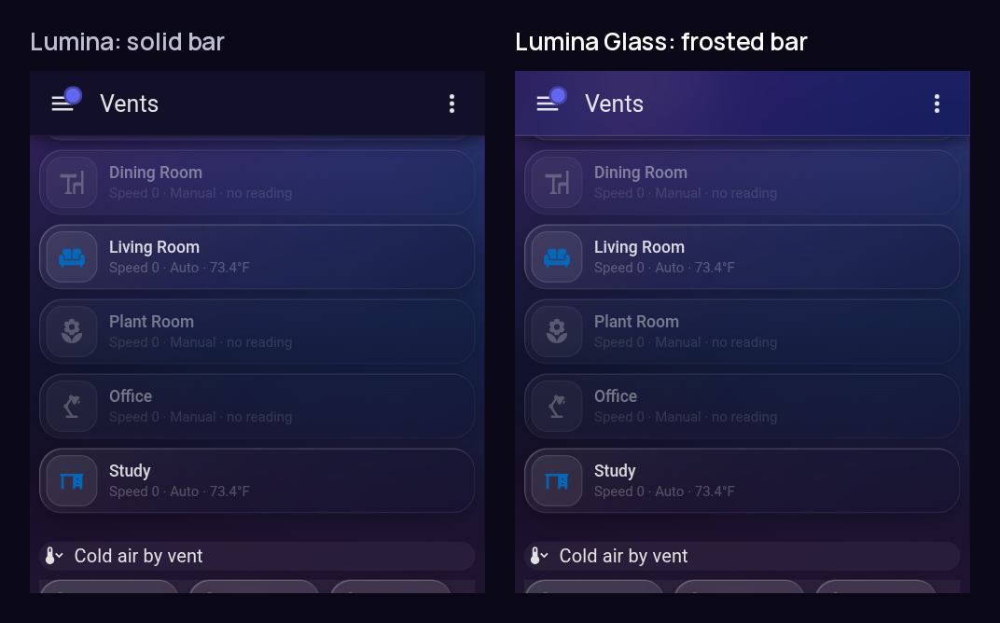
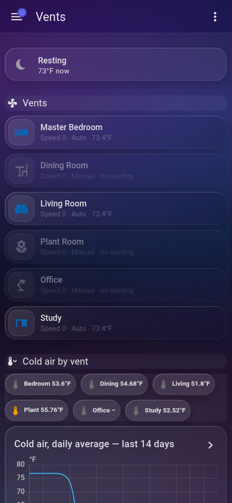
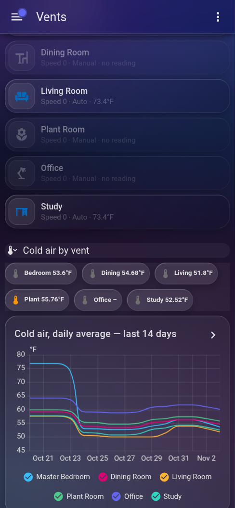
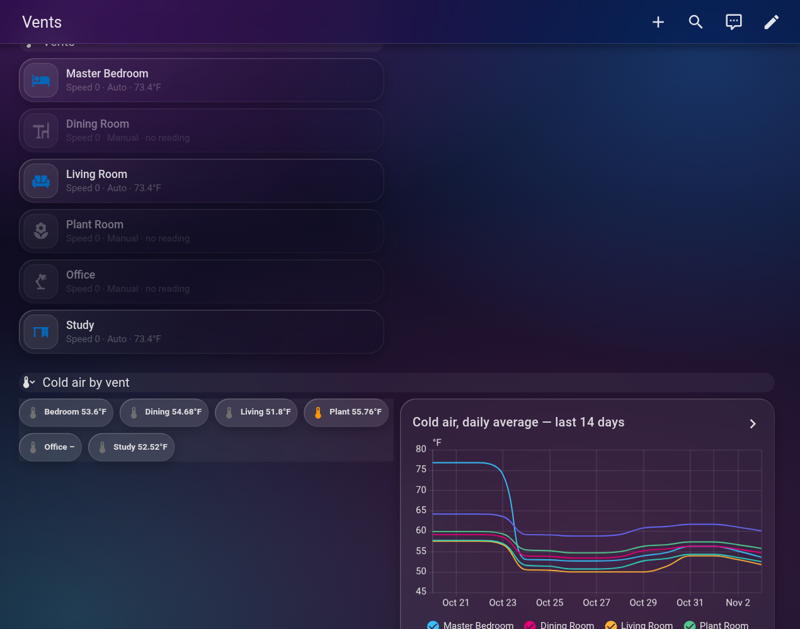

<p align="center"></p>

<p align="center">
  <a href="https://my.home-assistant.io/redirect/hacs_repository/?owner=nphil&repository=ha-lumina-glass&category=theme"></a>
  <a href="https://github.com/nphil/ha-lumina-glass/releases"></a>
  <a href="LICENSE"></a>
</p>

# Lumina Glass

**Lumina Glass** is the [Lumina](https://github.com/kjanko/lumina-homeassistant-theme) dark glass theme for Home Assistant, with a **frosted-glass top bar** that blends into the page.

Lumina gives every card frosted glass on a glowing background, but leaves the dashboard's top bar a solid navy strip. Lumina Glass makes that bar glass too: see-through, tinted and blurred, so the glow continues to the top of the screen and cards scrolling underneath stay soft and readable. On iPhone, where the Home Assistant app lets the page run up behind the clock and notch, the glass reaches up there as well.

<p align="center"></p>

<table>
  <tr>
    <td align="center"><br /><sub>On a phone</sub></td>
    <td align="center"><br /><sub>Scrolled: cards blur under the bar</sub></td>
  </tr>
</table>

<p align="center"></p>

Everything else is Lumina: glass Bubble Cards, glass room panels, glows in a light's own colour, one button style, greyed-out buttons, and a shared eight-colour palette. See the [theme reference](#theme-reference) below.

## Requirements

| | Tested with |
|---|---|
| Home Assistant | 2026.10 / 2026.11 |
| [Bubble Card](https://github.com/Clooos/Bubble-Card) | 3.4.2 |
| [card-mod](https://github.com/thomasloven/lovelace-card-mod) **or** [UIX](https://github.com/Lint-Free-Technology/uix) | card-mod 4.2.1 / UIX 8.4.0 |
| [stack-in-card](https://github.com/custom-cards/stack-in-card) (for glass panels) | 0.2.0 |

All are available in HACS. **UIX** (UI eXtension) is a drop-in replacement for card-mod: it reads the theme's `card-mod-*` keys and cards' `card_mod:` settings unchanged, so nothing needs converting. Install one of the two, not both.

## Installation

### HACS

1. Open HACS → ⋮ → **Custom repositories**.
2. Add `https://github.com/nphil/ha-lumina-glass` with category **Theme**.
3. Search for **Lumina Glass** and download it.

Or use the button: [](https://my.home-assistant.io/redirect/hacs_repository/?owner=nphil&repository=ha-lumina-glass&category=theme)

### Manual

Copy `themes/lumina-glass.yaml` into the `themes` folder in your Home Assistant config directory.

### Turn it on

1. Make sure Home Assistant loads themes from that folder. In `configuration.yaml`:
   ```yaml
   frontend:
     themes: !include_dir_merge_named themes
   ```
2. Restart Home Assistant, or call the `frontend.reload_themes` action.
3. Open your profile, set **Theme** to **Lumina Glass** and **Mode** to **Dark**.
4. Reload the page. In the phone app, close it fully and reopen it.

### Switching from Lumina

Both themes can be installed side by side; they have different names (`Lumina` and `Lumina Glass`) and different files. To switch, pick Lumina Glass in your profile. If you no longer want the original, remove it in HACS. Dashboards need no changes: every class (`glass`, `glass-inner`, `divider`, `lumina-glow`, `lumina-disabled`) and every `--lumina-*` variable is the same.

## The glass top bar

### Adjusting it

Three variables near the bottom of `themes/lumina-glass.yaml` (just above `modes:`) control the bar:

| Variable | Default | What it does |
|---|---|---|
| `lumina-header-background` | `rgba(10,8,23,0.35)` | Tint of the glass. Lower the last number for a clearer bar, raise it for a darker one (`1` is solid). |
| `lumina-header-blur` | `blur(24px) saturate(160%)` | How strongly content behind the bar is blurred. |
| `lumina-header-border` | `1px solid rgba(255,255,255,0.06)` | The faint line under the bar. Use `none` to remove it. |

Edits to a HACS-installed file are overwritten on update, so for lasting changes copy the theme under a new name.

### How it works

Home Assistant draws the dashboard bar as a fixed `.header` element inside `hui-root`. Lumina Glass sets the standard `app-header-background-color` and `app-header-text-color` variables, then uses a `card-mod-root` rule to:

- make `.header` itself transparent, and
- paint the glass on a `.header::before` layer behind the bar's contents. That layer extends 200px above the bar, so it also covers the strip behind the phone's status bar.

The blur sits on one layer that covers both the bar and the status-bar strip, rather than on the bar itself. If it sat on the bar, content scrolling through the strip above the bar would stay sharp. This is what you'd see in the iOS app.

`card-mod-root` needs card-mod or UIX. Without either, you get Lumina's original solid bar and the rest of the theme is unaffected.

## Credits

Lumina is by [kjanko](https://github.com/kjanko/lumina-homeassistant-theme) and licensed MIT; all of the card, panel, glow and palette design is theirs. Lumina Glass adds the glass top bar. The banner and Lumina screenshots in `docs/` are from the upstream project.

---

## Theme reference

The rest of this document is the upstream Lumina reference. It applies to Lumina Glass unchanged.

<p align="center"></p>

### Building blocks

The theme styles every card on its own. The pieces below need a line or two on the card. [`examples/dashboard.yaml`](examples/dashboard.yaml) uses all of them.

#### Glass panels

Put a room's cards in a `stack-in-card` with the `glass` class. For a device inside a room, nest another `stack-in-card` with `glass-inner`.

```yaml
type: custom:stack-in-card
card_mod:
  class: glass
cards:
  - type: custom:bubble-card
    card_type: separator
    name: Living Room
    icon: mdi:sofa-outline
  - type: custom:stack-in-card
    card_mod:
      class: glass-inner
    cards:
      - ...
```

#### Divider

A Bubble separator with no name, with the `divider` class:

```yaml
type: custom:bubble-card
card_type: separator
card_mod:
  class: divider
```

#### Glow

A card opts in from its Bubble `styles` by adding the `lumina-glow` class and setting two variables:

- `--glow`: the colour, as `r,g,b` (e.g. `255,180,50`) or a palette variable (e.g. `var(--lumina-green)`).
- `--glow-on`: the strength. `0` is off and looks like a plain card, `1` is the standard glow, and above `1` is stronger.

Optional: `--glow-dim` sets a second colour for the gradient, and `--glow-icon` sets an icon colour for glows too dark to use as one.

A light that glows in its own colour while it's on:

```yaml
styles: |
  ${(() => {
    card.classList.add('lumina-glow');
    const [r, g, b] = hass.states[entity]?.attributes?.rgb_color || [255, 180, 50];
    const on = state === 'on';
    return `.bubble-button-card-container {
      --glow: ${on ? `${r},${g},${b}` : '255,255,255'};
      --glow-on: ${on ? 1 : 0};
    }`;
  })()}
```

A switch that is green when on and red when off:

```yaml
styles: |
  ${(() => { card.classList.add('lumina-glow'); return ''; })()}
  .bubble-button-card-container {
    --glow: ${state === 'on' ? 'var(--lumina-green)' : 'var(--lumina-red)'};
    --glow-on: ${state === 'on' ? 0.65 : 0.4};
  }
```

#### Buttons

Every Bubble sub-button with a background gets the same look: a tint of its colour, a crisp 1px edge in its colour that's lighter along the top and left, and an icon in the colour. A card only sets the colour, per button, with `--btn` (an `r,g,b` triplet or a palette variable). Without it a button is cyan.

A button that is off looks like a plain grey Lumina button: set `--btn: var(--lumina-neutral); --btn-off: 1`.

```yaml
styles: |
  .bubble-sub-button-1 { --btn: var(--lumina-red); }  /* stop */
  ${(() => {
    const open = state === 'open';
    return `.bubble-sub-button-2 { --btn: ${open ? 'var(--lumina-teal)' : 'var(--lumina-neutral); --btn-off: 1'}; }`;
  })()}
```

Sub-buttons with `show_background: false` stay plain text or icons.

#### Greyed out

Add `lumina-disabled` to a card, or to one of its buttons, while its action would do nothing. It is dimmed, grey and can't be tapped.

```yaml
styles: |
  ${(() => {
    const off = ['off', 'unavailable', 'unknown'].includes(hass.states['media_player.tv']?.state);
    card.classList.toggle('lumina-disabled', off); // the whole card
    card.querySelector('.bubble-sub-button-1')?.classList.toggle('lumina-disabled', off); // or one button
    return '';
  })()}
```

#### Palette

Each colour is an `r,g,b` triplet, so it works as a `--glow` value and in `rgba(var(--lumina-green), 0.3)`.

| Variable | Colour |
|---|---|
| `--lumina-amber` | 255,180,50 |
| `--lumina-green` | 80,200,140 |
| `--lumina-teal` | 45,212,191 |
| `--lumina-cyan` | 56,189,248 |
| `--lumina-blue` | 100,180,255 |
| `--lumina-indigo` | 99,102,241 |
| `--lumina-red` | 220,80,80 |
| `--lumina-magenta` | 226,0,116 |

### Customising

All sizes and colours are variables at the top of `themes/lumina-glass.yaml`: radii, card and icon backgrounds, border, shadows, text colours, blur, the glass panel look, the separator line, the divider and the background. Change them there, or make a copy of the theme under a new name.

The background is `lovelace-background`. A dashboard view with its own `background` replaces it.

### Good to know

- **Other cards.** Standard cards (graphs, thermostats, gauges, entities, weather) get the glass background, rounded corners and palette colours from Home Assistant's own theme variables. Their layout stays Home Assistant's own; only Bubble Card gets the glow and greyed-out styles.
- **Edges in a card's own colour.** A Bubble card's edge uses its glow colour. A card that wants a coloured edge without glowing sets `--glow` and `--glow-on` on `.bubble-button-card-container`, and `.bubble-button-card-container::before { display: none !important; }` removes the edge from a card that shouldn't have one (e.g. a header without a background).
- **Card styles and the theme.** The glow, greyed-out and glass rules use `!important` so they win over Bubble's inline colours. A card's own rule that should beat them needs a more specific selector, e.g. `ha-card .bubble-separator .bubble-line` instead of `.bubble-line`.
- **Cards that appear later.** Cards created after the page loads, such as inside a `conditional` card, may not pick up theme styles until the page is reloaded. To show and hide rows, keep the cards on the page and hide them from their own styles instead:
  ```yaml
  styles: |
    ${hass.states['input_boolean.show_more']?.state === 'on' ? '' : ':host { display: none !important; }'}
  ```

### License

[MIT](LICENSE)
